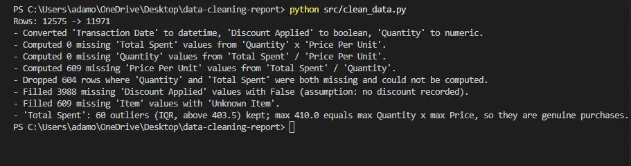

# Retail Store Sales: Data Cleaning & Quality Audit

A reproducible data cleaning pipeline and quality audit for a deliberately "dirty" retail transactions dataset (CodeNova Data Science Internship, Task 2).

## Features
- Diagnostic scan: missing values, hidden missing values, duplicates, wrong data types, impossible values, relations between columns.
- Outlier detection with the IQR method (outliers are flagged and documented, not blindly removed).
- Documented cleaning strategy for every column, with a rationale for each dropped or imputed record.
- Missing values derived from a verified relation (`Total Spent = Quantity x Price Per Unit`) instead of guessed.
- Built-in validation checks that stop the script if the result is inconsistent.
- Raw data is never modified; clean data is written to a separate path.

## Tech stack
Python 3, pandas, Jupyter Notebook.

## Project structure
```
data-cleaning-report/
├── data/
│   ├── raw/retail_store_sales.csv        # original data (never modified)
│   └── clean/retail_store_sales_clean.csv
├── notebooks/01_exploration.ipynb        # step-by-step exploration and cleaning
├── src/clean_data.py                     # automated, reproducible cleaning script
├── reports/
│   ├── data_quality_audit.md             # full audit report
│   ├── cleaning_log.csv                  # one line per cleaning step
│   ├── before_after_comparison.csv       # nulls and statistics before/after
│   └── figures/script_output.png
├── .gitignore
├── requirements.txt
└── README.md
```

## Setup and usage
```bash
pip install -r requirements.txt
python src/clean_data.py
```
The script reads `data/raw/retail_store_sales.csv` and writes the clean dataset, the cleaning log and the before/after table.



## Results summary
| | Before | After |
|---|---|---|
| Rows | 12,575 | 11,971 |
| Missing cells | 7,229 | 0 |
| Duplicates | 0 | 0 |

Main decisions:
- 609 missing `Price Per Unit` values were computed from `Total Spent / Quantity`.
- 604 rows with both `Quantity` and `Total Spent` missing were dropped (they cannot be recovered).
- 60 high `Total Spent` outliers were kept: the maximum (410) equals 10 x 41, the largest possible purchase.
- Missing `Discount Applied` values were set to `False` as an explicit assumption (see the limitations in the audit report).

Full details: [reports/data_quality_audit.md](reports/data_quality_audit.md).

## Dataset
Kaggle: "Retail Store Sales: Dirty for Data Cleaning" - <https://www.kaggle.com/datasets/ahmedmohamed2003/retail-store-sales-dirty-for-data-cleaning>. License: <[CC BY-SA 4.0](https://creativecommons.org/licenses/by-sa/4.0/)>.

## Author
Adamos Antoniou - [GitHub](https://github.com/AdamosAnt10) - [LinkedIn](https://www.linkedin.com/in/adamos-antoniou-b467373a6/)